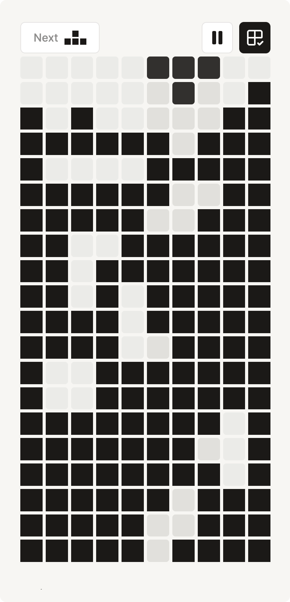

# TsumiZare "積戯"

https://tsumizare.app/



Hono・React Server Components・Viteで構築し、Cloudflare Workersへ配信するパズルゲーム。
ルーティングとHTML/Flight変換は
`@yoshikouki/hono-file-router` と `@yoshikouki/hono-rsc-renderer` が担う。
ゲーム状態はブラウザ内のReactで持ち、結果画像の保存・共有もブラウザ内で処理する。
ゲームロジックは [blocky-game](./packages/blocky-game/) に分けている。

## 開発

```sh
bun install --frozen-lockfile
bun dev
```

コマンドは `package.json` の `scripts`、PRで通す検証は
`.github/workflows/ci.yml` の `validate` ジョブが正本。
`bun run test:worker` はビルド済みの `dist` を検証するので、先に `bun run build` を実行する。

## 配信

`main` へのpushはGitHub Actionsで検証し、検証した成果物をそのまま配信する。
`Production` Environmentに `CLOUDFLARE_API_TOKEN` が必要。
Workerコードと静的アセットはこのリポジトリ、独自ドメインとDNSは
`yoshikouki/personal-infra` の `terraform/cloudflare/tsumizare.tf` が管理する。
Wranglerに独自ドメインやrouteを追加して管理を二重化しない。

`/healthz` で配信中のGit SHAとWorker version IDを確認できる。
配信検証は `bun run scripts/smoke-deployment.ts <URL> [Git SHA] [version ID]`。
配信後の検証に失敗すると、CIは直前のWorker versionへ戻す。
複数のversionへ分割配信している間はCIが配信しないので、先に1つのversionへ揃える。
